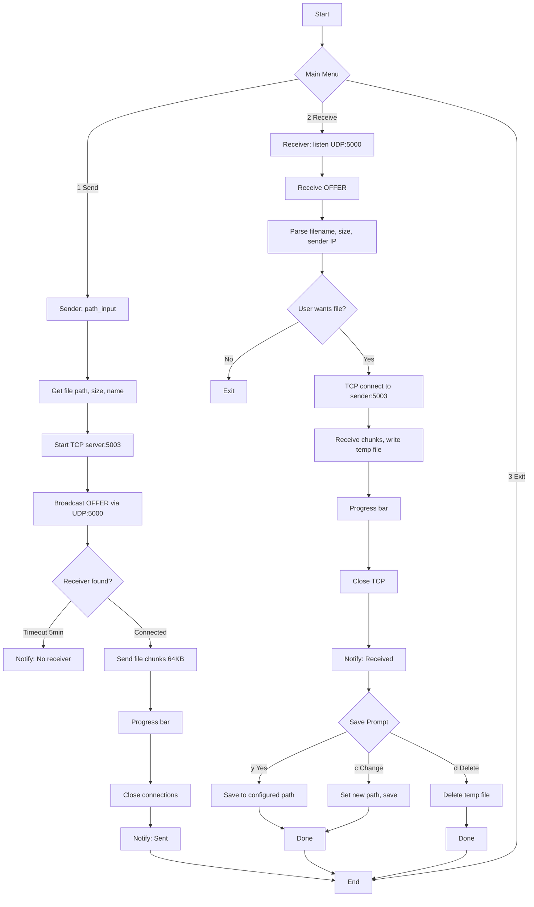

# fileter

Local file transfer over Wi-Fi (no Bluetooth, no internet). Send files between devices on the same network.

## Features

- **Fast**: Direct TCP transfer over LAN
- **Simple**: No accounts, no configuration
- **Cross-platform**: Python 3.10+ (Windows, macOS, Linux)
- **Interactive save prompt**: Choose where to save or delete on receive

## Quick Start

```bash
# Install dependencies
pip install -r requirements.txt

# On receiving device
python Main.py
# Choose [2] Receive

# On sending device
python Main.py
# Choose [1] Send
# Enter file path
```

### Or download a release build

Prebuilt binaries for Windows, macOS, and Linux are attached to each [GitHub Release](https://github.com/<your-username>/fileter/releases). Download the one for your platform:

- `fileter-windows-latest.exe` (Windows)
- `fileter-macos-latest` (macOS)
- `fileter-ubuntu-latest` (Linux)

Make it executable (`chmod +x fileter-macos-latest` on macOS/Linux) and run it instead of `python Main.py`.

## Requirements

- Python 3.10+
- `tqdm` (progress bars)
- `plyer` (desktop notifications)

```bash
pip install tqdm plyer
```

## Architecture

```
+----------------+           UDP Broadcast (port 5000)            +----------------+
|    SENDER      |  ------------------------------------------->  |   RECEIVER     |
|                |  "OFFER|filename|filesize"                     |                |
| 1. Select file |                                                | 1. Listen      |
| 2. Start TCP   |                                                | 2. Show prompt |
|    server:5003 |                                                |    [1] Yes     |
| 3. Wait...     |                                                |    [2] No      |
+----------------+                                                +-------+--------+
                                                                          |
                                                                          v
                                                                 +--------+--------+
                                                                 |  TCP Connect    |
                                                                 |  (port 5003)    |
                                                                 |                 |
                                                                 |  Stream chunks  |
                                                                 |  64KB at a time |
                                                                 +--------+--------+
                                                                          |
                                                                          v
                                                                 +--------+--------+
                                                                 |  Save Prompt    |
                                                                 |                 |
                                                                 | [y] Yes         | --> Move to saved/default path
                                                                 | [c] Change      | --> Set new path, save there
                                                                 | [d] Delete      | --> Remove temp file
                                                                 +-----------------+
```

## Flowchart



## Project Structure

```
fileter/
├── Main.py       # Entry point, menu
├── Sender.py     # Broadcast + TCP send
├── Receiver.py   # Listen + TCP receive + save prompt
├── Saver.py      # Config persistence (~/.fileter_save_path)
├── SaverUI.py    # Save prompt UI (y/c/d keys)
└── requirements.txt
```

## Configuration

Save path stored in `~/.fileter_save_path`. Defaults to `~/Downloads`.

Change it via the `[c] Change` option when receiving a file.

## How It Works

1. **Sender** broadcasts `OFFER|filename|size` on UDP port 5000
2. **Receiver** hears broadcast, shows file info + `[1] Yes / [2] No`
3. If **Yes**, receiver TCP-connects to sender on port 5003
4. **Sender** streams file in 64KB chunks with progress bar
5. **Receiver** writes to `received_<filename>` in project dir
6. **Save Prompt** appears:
   - `y` → Move to saved/default folder
   - `c` → Pick new folder, save there, remember it
   - `d` → Delete temp file

## License

MIT